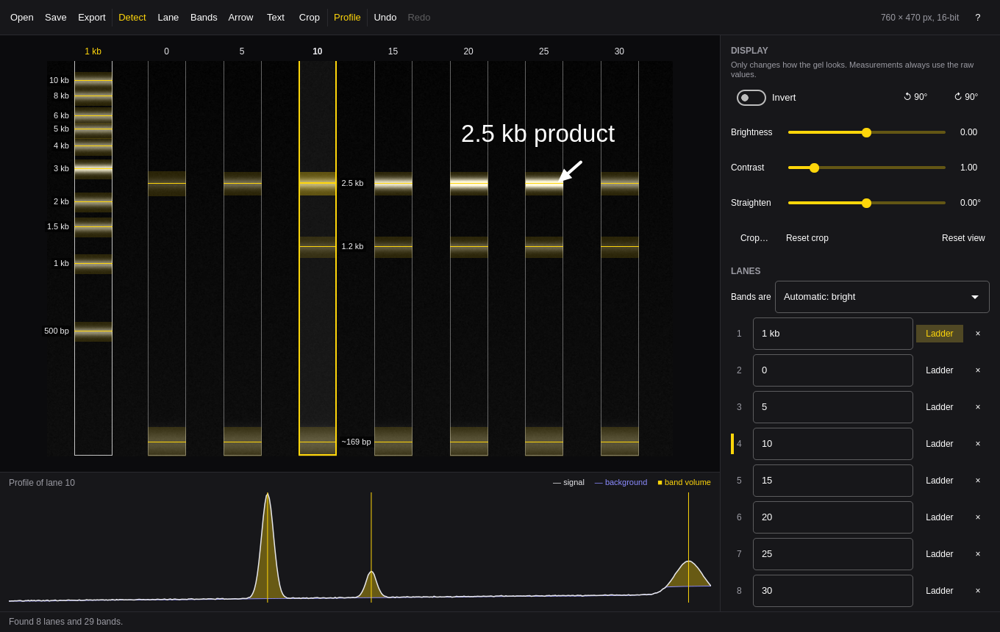
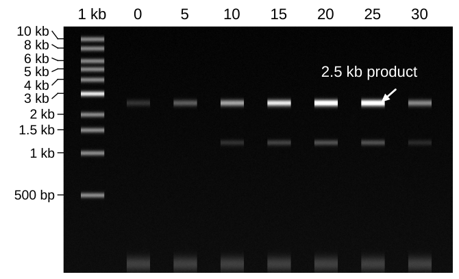

# Gel

Annotate and quantify an agarose gel or Western blot image, and export a
figure ready for publication. One window, driven from the keyboard, following
the Omarchy theme and language.



Open a PNG, JPEG, or TIFF (8 or 16 bits) and press Space. Gel finds the lanes
and the bands in them, sizes every band against the ladder lane, and measures
its background-subtracted volume. Label the lanes, pick a loading control to
normalize to, add arrows and text, then export the figure as PNG, SVG, or PDF
at the resolution a journal asks for, and the numbers as CSV.



The image itself is only ever read. Inverting, brightening, turning, and
cropping change how it looks, never what it measures, and are listed in every
exported figure's metadata.

## Install

On Omarchy:

```sh
bin/install
```

This builds the app and installs it as the `gel` package, so it shows up in
the app launcher (Super + Space). It needs `qt6-base`, `qt6-declarative`,
`qt6-svg`, `qt6-imageformats` (for TIFF), and `qt6-wayland`.

## Use

Open an image with Ctrl+O, or drop it on the window. A session is saved as a
`.gel` file next to the image (`blot.tif` → `blot.gel`), and opening the image
again brings it back.

1. **Lanes.** Space finds them. Drag a lane to move it, drag its edges to
   resize it, or press L to add one under the pointer. Name each lane in the
   side panel or by double-clicking its label above the gel.
2. **Bands.** Space finds the bands in every lane too. Press B and click in a
   lane to add a band at the nearest peak, or to remove one. Bands you pick by
   hand stay when you press Space again.
3. **Ladder.** Mark one lane as the ladder and pick its preset: 1 kb, 100 bp,
   1 kb Plus, or Protein kDa. The sizes are editable for other markers. Every
   other band then gets a size, and the ladder's sizes are shown beside it.
4. **Normalize.** Pick a reference lane or a reference band (a loading
   control), or double-click a row in the results table.
5. **Annotate.** A draws an arrow, T places text. Both show at the size they
   will print.
6. **Export.** Ctrl+E: PNG, SVG, or PDF at any resolution and width (85 mm is
   one journal column), or the results as CSV.

### Keys

| Key | Action |
| --- | --- |
| Space | Find lanes and bands, and quantify |
| Shift+Space | Find the lanes again too |
| L | Add a lane under the pointer |
| B | Pick bands: click in a lane to add or remove one |
| P | Show or hide the lane profile |
| I | Invert the display |
| R / Shift+R | Turn 90° clockwise / counterclockwise |
| [ / ] | Straighten by a quarter degree |
| C | Crop: drag the area to keep |
| A | Draw an arrow |
| T | Place a text label |
| Arrow keys | Nudge the selected lane, band, or annotation (Shift: 10 px) |
| Delete | Remove the selection |
| Ctrl+Z / Ctrl+Shift+Z | Undo / redo |
| Ctrl+O | Open an image or session |
| Ctrl+S | Save the session next to the image |
| Ctrl+E | Export the figure or the results |
| Esc | Leave the current mode |
| ? | Show every shortcut |
| Q | Quit (asks first when there is unsaved work) |

## Command line

Every command runs without a display, takes `--json`, and exits 1 with the
reason on stderr when it fails.

```sh
gel lanes blot.tif --save          # detect lanes and bands, write blot.gel
gel quant blot.gel --json          # size, volume, normalized volume per band
gel export blot.gel --pdf fig.pdf --dpi 600 --width-mm 175
gel export blot.gel --csv results.csv
gel check blot.gel                 # every problem with a session
gel skill install                  # teach coding agents to use gel
gel open blot.tif                  # the window
```

`gel quant` and `gel export` also take an image with no session; lanes and
bands are then detected on the spot. The `.gel` file is plain JSON, so it can
be edited directly; `gel skill` describes its fields.

## How it measures

- **Signal.** Gel works on the raw pixel values: 0 to 65535 for a 16-bit
  scan, 0 to 255 for an 8-bit or color image (converted to luminance). Bright
  bands on a dark gel (stained DNA, fluorescence) count up from black; dark
  bands on a light background (film, colorimetric blots) count down from
  white. Which one an image is gets detected from its histogram, and can be
  set by hand.
- **Profile.** Each lane is averaged across its width, row by row, through the
  turn and straightening you set, with bilinear sampling of the raw values.
- **Background.** The default is a *rolling ball*: a straight baseline is fitted
  under the profile first, so a sloped background doesn't lift the ball into
  the bands, then a ball of the chosen radius (in pixels; make it larger than
  the widest band) is rolled underneath. *Lane edges* instead averages thin
  strips just outside both sides of the lane, which follows a background that
  changes down the gel or across it.
- **Volume.** A band runs from its peak out to where the background-subtracted
  profile fades to 3% of the peak or turns up toward a neighbor. Its volume is
  the sum of the background-subtracted pixel values in that region, in raw
  units times pixels.
- **Normalization.** Each volume divided by the reference band's volume, or by
  the total volume of the reference lane.
- **Size.** log₁₀(size) is fitted against migration distance through the
  ladder's bands, matched from the top: a cubic with six or more bands, a
  quadratic with four or five, a line with two or three, and a lower degree
  whenever a curve would stop decreasing. R² is shown with the fit. A size
  outside the ladder's range is marked `~` (extrapolated) and is unreliable.

### Limits

- **Saturation.** A pixel at the format's maximum (or at zero, for dark bands)
  was clipped by the scanner or camera, and the true signal there is unknown.
  Gel counts these pixels per band and warns; such a band's volume is an
  underestimate and should not be reported. Rescan at a shorter exposure.
- **Linear range.** Volumes are proportional to the amount of material only
  within the linear range of the stain, film, or detector. Film and
  chemiluminescence saturate well before the pixel maximum, and stains have a
  lower detection limit. Check with a dilution series on the same gel before
  comparing amounts, and keep loading controls within that range too.
- **Comparisons.** Volumes are only comparable within one image. Compare
  across gels through normalized values against a shared reference.
- **Images.** Use the scanner's original file. JPEG compression and
  auto-contrast in other software change the values. 12-bit cameras that save
  into 16-bit files saturate below 65535, which Gel can't detect.
- **Geometry.** Lanes are straight and vertical in the turned image. Curved
  ("smiling") lanes or bands that run into each other are measured
  approximately. Narrow the lane, or pick the bands by hand.

## Development

```sh
bin/build    # qmake6 + make into build/gel
bin/test     # analysis, window, and command-line tests
```

`tests/synthetic.h` makes the synthetic gels the tests measure: Gaussian bands
at known positions and amounts on sloped, noisy backgrounds. They check lane
and band detection, ladder sizes (within 5%), background subtraction,
normalization, the session's JSON round trip, that the source image is never
changed, and that display adjustments leave every number alone. The window
tests drive the real QML offscreen with the mouse and keyboard; set
`GEL_UI_SHOTS` to a directory to keep a screenshot of each.

Translations live in `src/i18n/` as JSON keyed by the English text. Gel ships
English, Danish, German, and Spanish, and follows the language picked under
Omarchy's Setup > Language.

## License

MIT. See [LICENSE](LICENSE).
